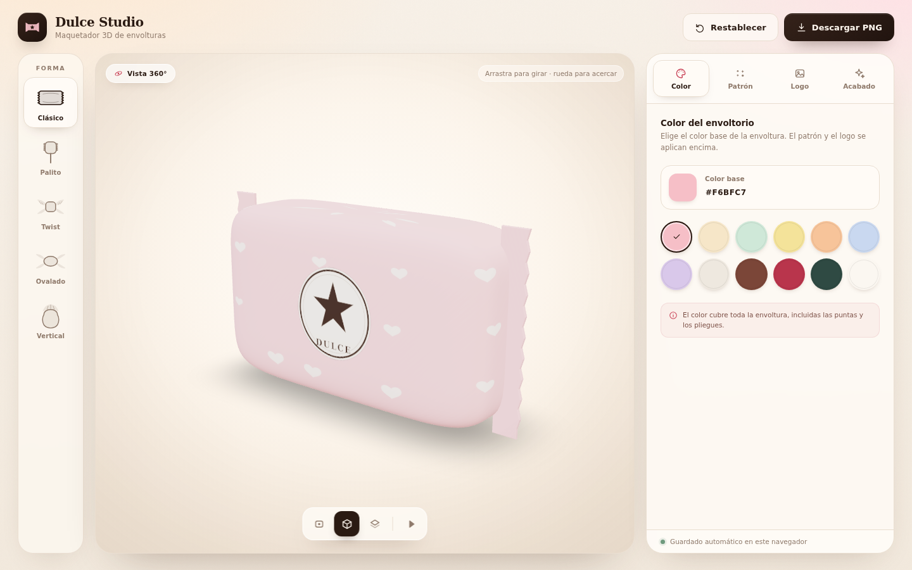

# Dulce Studio

Maquetador 3D de envolturas de dulces: sube el logo de tu empresa, cambia el color
del papel, aplica patrones y revisa el resultado en 360° antes de imprimir.



## Funciones

- **5 formas de dulce** generadas por código: clásico, palito, twist, ovalado y vertical.
- **Vista 360°** con arrastre, zoom, giro automático y vistas frontal / 3⁄4 / superior.
- **Logo proyectado** sobre la superficie real del dulce (sigue la curvatura y los pliegues).
- **Color y patrón** con corazones, estrellas, lunares, rayas o confeti.
- **Acabados**: mate, satinado, brillante y metalizado.
- **Iluminación**: estudio, cálida y fría.
- **Exportación PNG** en 1K, 2K o 4K, con fondo transparente o de color.
- **Autoguardado** en el navegador.
- Funciona **sin conexión** una vez cargada; no usa CDN ni fuentes externas.

## Requisitos

- Node.js 22 o superior (probado con Node 22.22 y npm 9).
- Un navegador con WebGL 2 (Chrome, Edge, Firefox o Safari recientes).

## Desarrollo

```bash
npm install
npm run dev
```

Abre `http://localhost:5173`.

## Compilar

```bash
npm run build
npm run preview
```

La carpeta `dist/` contiene la aplicación estática.

## Docker

```bash
docker compose up --build
```

Abre `http://localhost:8080`.

La imagen es multi-etapa: Node compila y Nginx (sin privilegios) sirve el resultado.
Pesa mucho menos que una imagen con Node en producción y arranca en segundos.

Para parar el contenedor:

```bash
docker compose down
```

> **Importante:** el proyecto se guarda en `localStorage` del navegador. Si cambias
> el puerto (por ejemplo de `8080` a `3000`), el navegador lo considera otro origen y
> los diseños guardados no aparecerán. Usa siempre el mismo puerto.

## Cómo se usa

1. Elige la forma del dulce en la barra izquierda.
2. En **Color**, selecciona el color base.
3. En **Patrón**, elige el motivo y ajusta escala, densidad y rotación.
4. En **Logo**, arrastra tu archivo (PNG, SVG, JPG o WebP) y colócalo con los controles.
5. En **Acabado**, elige el material, la luz y el fondo del PNG.
6. Pulsa **Descargar PNG** y selecciona resolución y fondo.

Consejos:

- Un logo **PNG con transparencia** se integra mejor con el color del papel.
- Los logos raster se reducen a 1200 px para que quepan en el almacenamiento del
  navegador; los SVG se conservan vectoriales.
- El fondo transparente se exporta sin sombra para poder montar el dulce sobre
  cualquier diseño.

## Estructura

```
src/
  App.tsx                  composición general y exportación
  store/editor.ts          estado (Zustand + persistencia)
  three/
    geometry.ts            generadores procedurales de las 5 formas
    textures.ts            patrón de impresión y normal map
    CandyScene.tsx         escena, materiales, logo y luces
    useLogoTexture.ts      carga y liberación de la textura del logo
    exportPng.ts           render offscreen a PNG
  components/
    ShapeRail.tsx          selector de forma
    Viewer.tsx             visor 3D y vistas de cámara
    EditorPanel.tsx        panel lateral con pestañas
    panels/                Color, Patrón, Logo y Acabado
    ui/                    Slider y selector de color
    Icons.tsx              iconografía SVG
  index.css                sistema visual completo
```

## Decisiones técnicas

- **Geometría procedural** en lugar de GLB: cero assets, menos peso y parámetros
  ajustables (torsión, pliegues, radios). Las normales se calculan a partir de la
  propia superficie para evitar costuras visibles.
- **Textura de impresión** generada en canvas y cacheada; se regenera con retardo
  para no bloquear el hilo principal mientras se mueven los controles.
- **Logo mediante `DecalGeometry`**: se proyecta sobre la malla, por lo que sigue la
  curvatura y no queda como una calcomanía plana.
- **Render bajo demanda** (`frameloop="demand"`): la escena solo se dibuja cuando hay
  cambios, salvo que el giro automático esté activo.
- **Materiales separados para las puntas**: las superficies plegadas reciben un
  acabado más mate para que conserven el color del papel y no se quemen con el brillo.
- **Sin dependencias de red**: el entorno de estudio se genera en un canvas con un
  degradado suave, no con HDRI descargados.

## Limitaciones conocidas

- El logo se coloca en la cara frontal (y opcionalmente en la trasera); no se edita
  un dieline de imprenta.
- La exportación es una captura del ángulo actual, no un render por lotes.
- El almacenamiento local del navegador ronda los 5 MB; si subes muchos logos muy
  grandes, puede llenarse. La app reduce las imágenes automáticamente a 1200 px.
